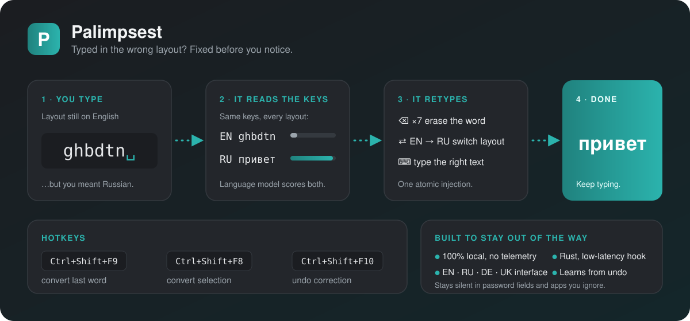
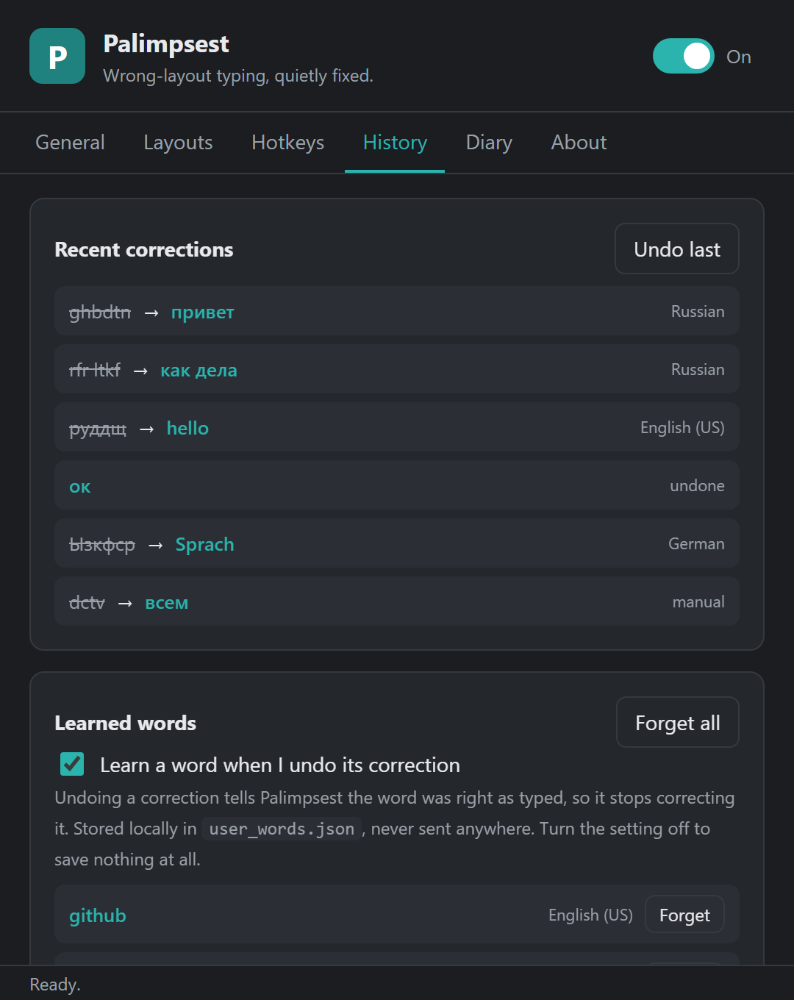
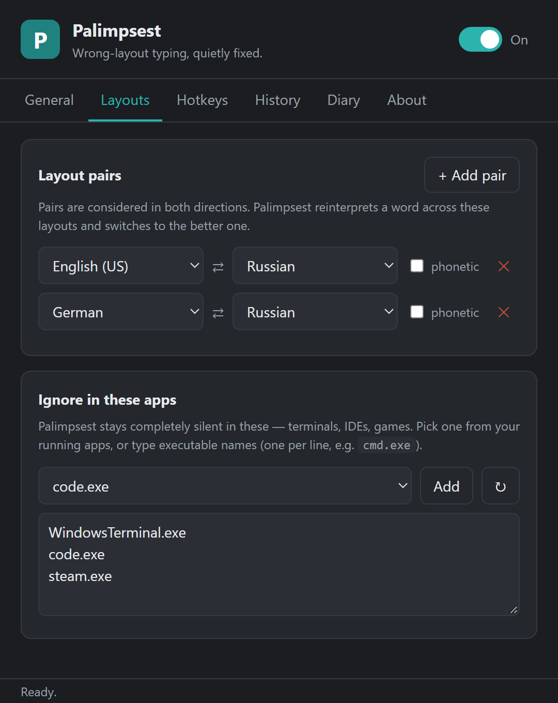
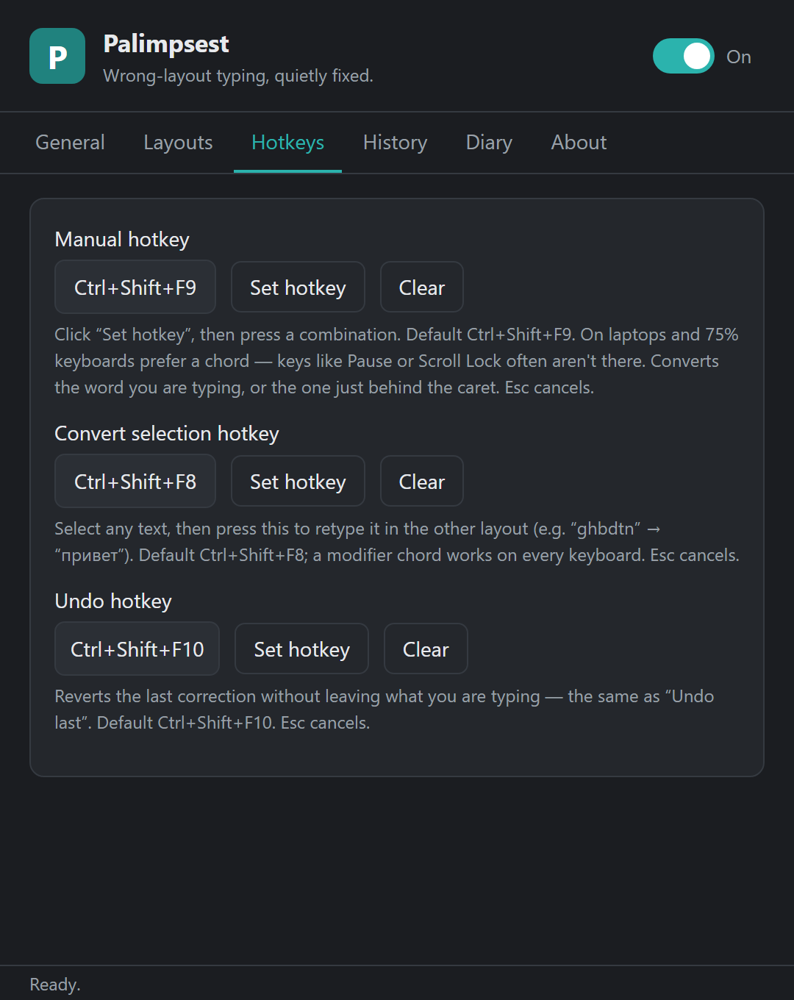
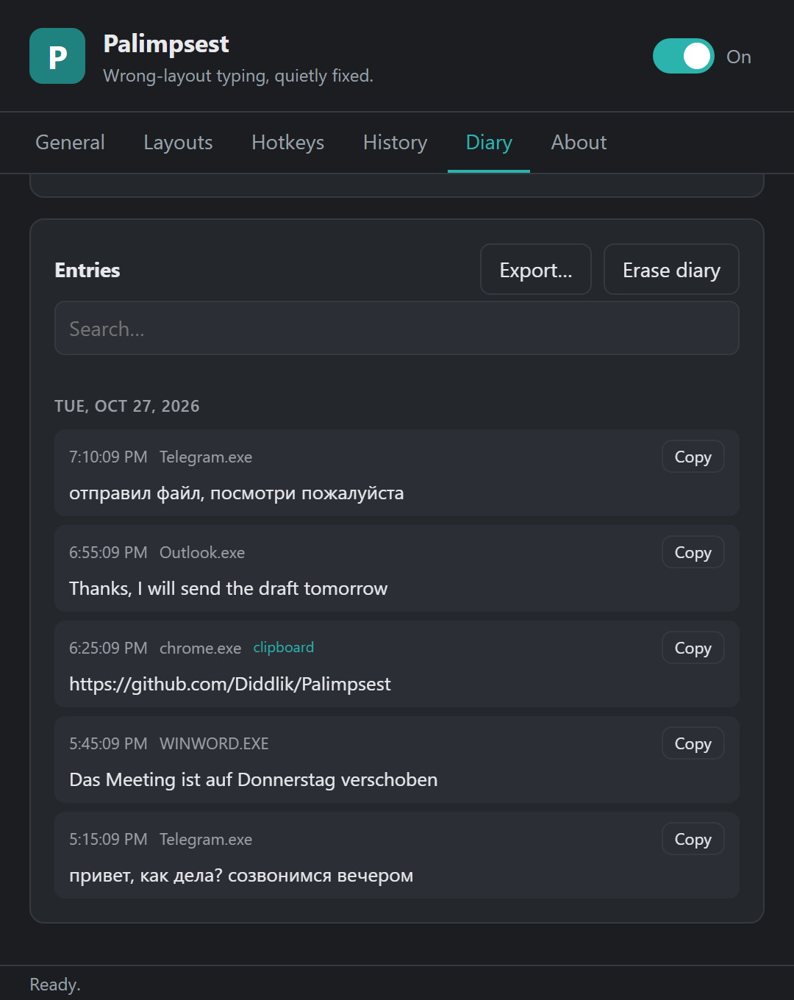

**English** · [Русский](README.ru.md)

# Palimpsest

**Typed in the wrong keyboard layout? Palimpsest fixes it before you notice.**

Type `ghbdtn` with the English layout active and Palimpsest turns it into
`привет`, switches Windows to Russian, and lets you keep typing. It works like
Punto Switcher, Mahou, or Caramba Switcher, but runs fully local, is written in
Rust, and corrects only when it is confident.



## Install

Download `Palimpsest_<version>_x64-setup.exe` from the
[latest release](https://github.com/Diddlik/Palimpsest/releases/latest) and run
it. It installs per user, needs no admin rights, and updates itself from
Settings → General → Updates.

The installer is not code-signed yet, so SmartScreen may warn on first run
(**More info → Run anyway**).

## Features

- **Automatic correction** while you type, for EN ⇄ RU, EN ⇄ DE, DE ⇄ RU, and
  any other alphabetic layout pair you configure.
- **Three hotkeys**: convert the last word, convert the selection, undo.
- **Conservative by design**: a sensitivity slider, an ignore list for
  terminals, IDEs and games, and silence in password fields.
- **Learns from undo**: undo a correction once and that word is left alone.
- **Typing diary** (optional, off by default): a searchable, exportable log of
  what you typed, with optional clipboard capture and password encryption.
- **Interface in English, Russian, Ukrainian, and German**, following the
  Windows language by default.
- **Tray app**: left-click pauses, right-click opens the menu. Settings apply
  live.

## Screenshots

| History | Layouts |
|---|---|
|  |  |
| **Hotkeys** | **Diary** |
|  |  |

## Hotkeys

| Default | Action |
|---|---|
| `Ctrl+Shift+F9` | Convert the word you are typing, or the one just behind the caret |
| `Ctrl+Shift+F8` | Convert the selected text |
| `Ctrl+Shift+F10` | Undo the last correction |

All three can be changed or turned off in Settings → Hotkeys.

## Privacy

- Typed text never leaves your machine, under any setting.
- The only network request is the update check. It sends no identifiers, and
  updates are verified against a signing key built into the app.
- Diagnostic logs never contain typed text at the default level.

Only two features write typed text to disk, both under
`%APPDATA%\com.palimpsest.desktop\`, and both can be viewed and erased in
Settings:

- **Learned words** (`user_words.json`, on by default): one word per undo,
  nothing else.
- **Typing diary** (`diary.json`, off by default): a real keystroke log. Anyone
  with access to your user profile can read it unless you set a diary password,
  which encrypts it (Argon2id + XChaCha20-Poly1305). A forgotten password cannot
  be recovered. Retention is limited by entry count (500 by default), age, and
  file size.

### Administrator windows

Windows does not let a normal process type into elevated windows, UAC prompts,
or the lock screen. Turn on **Always run as administrator** in Settings →
General if you need corrections in admin apps. It uses one UAC-approved
scheduled task and stays elevated across logins and updates.

## How it works

Palimpsest runs three threads:

- **Hook thread** owns `WH_KEYBOARD_LL`. It reads the key, forwards a tiny event,
  and returns at once, because Windows silently removes slow hooks.
- **Engine thread** collects a word until a space, reinterprets the scan codes
  under each configured layout with `ToUnicodeEx`, and scores every reading with
  per-language bigram models. If another layout clearly wins, it sends the
  backspaces, the layout switch, and the corrected text as one injection.
- **UI thread** is a Tauri 2 tray app with the settings window.

Its own input is tagged through `dwExtraInfo`, so Palimpsest never corrects what
it typed itself. Shortcuts such as `Ctrl+V` drop the current word, so pasted
text is never touched.

## Build from source

Requires Windows and the Rust stable toolchain (`x86_64-pc-windows-msvc`).

```powershell
cargo test --workspace
cargo clippy --workspace --examples
cargo run -p palimpsest-app            # tray + settings
```

Installer (needs `cargo install tauri-cli --version "^2"`):

```powershell
cd crates/palimpsest-app
cargo tauri build
# → target/release/bundle/nsis/Palimpsest_<version>_x64-setup.exe
```

### Releasing

Releases are built by GitHub Actions from a `v*` tag. `scripts/bump.ps1` updates
`Cargo.toml`, `tauri.conf.json`, and `Cargo.lock` together, then commits, tags,
and pushes:

```powershell
./scripts/bump.ps1                 # patch: 0.4.1 -> 0.4.2
./scripts/bump.ps1 -Part minor     # 0.4.2 -> 0.5.0
./scripts/bump.ps1 -Version 1.0.0  # explicit
./scripts/bump.ps1 -DryRun         # show the plan, change nothing
```

## Status

Every feature above is implemented and ships in the releases. Still open:
code signing with an OV/EV certificate, and long soak and performance testing.

## License

Apache-2.0. See [LICENSE](LICENSE).
