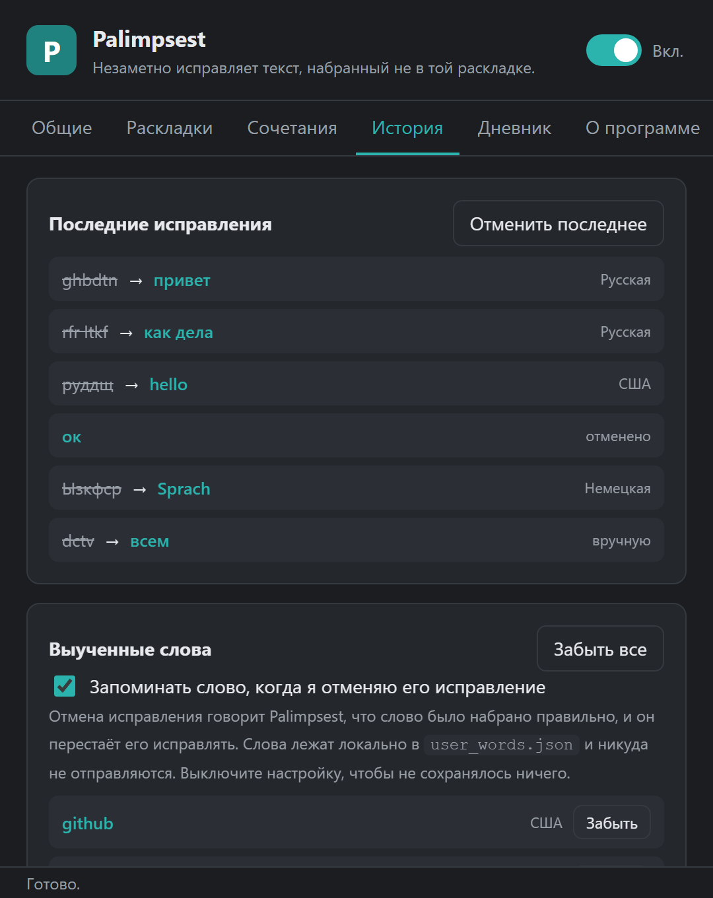
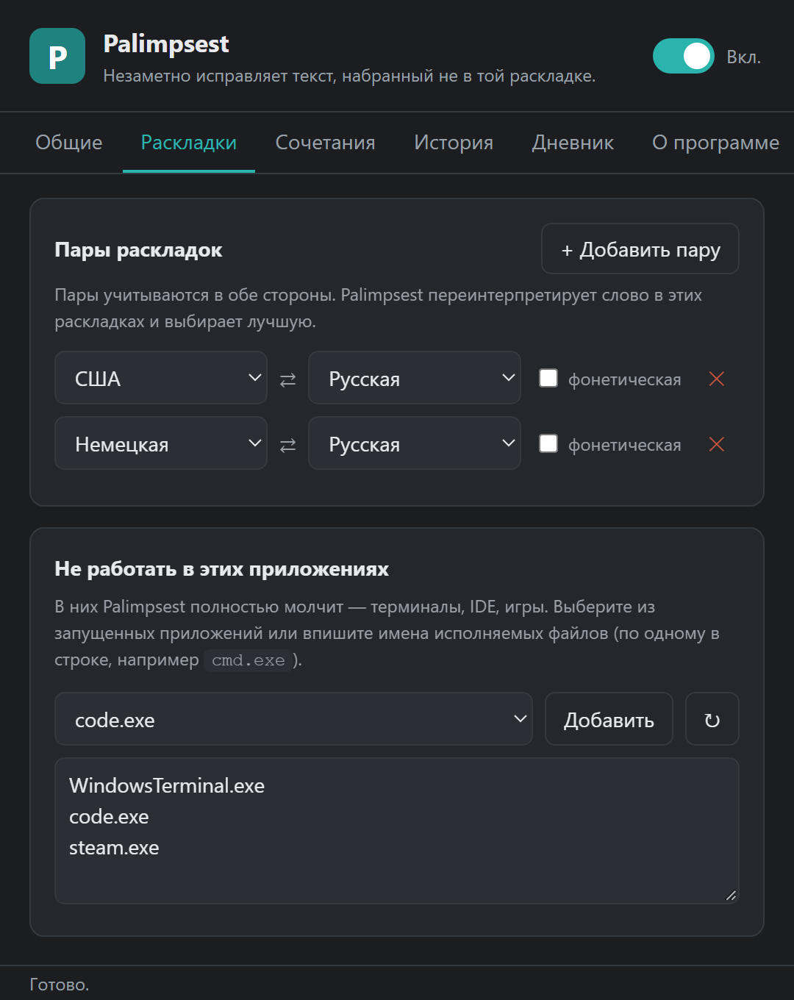
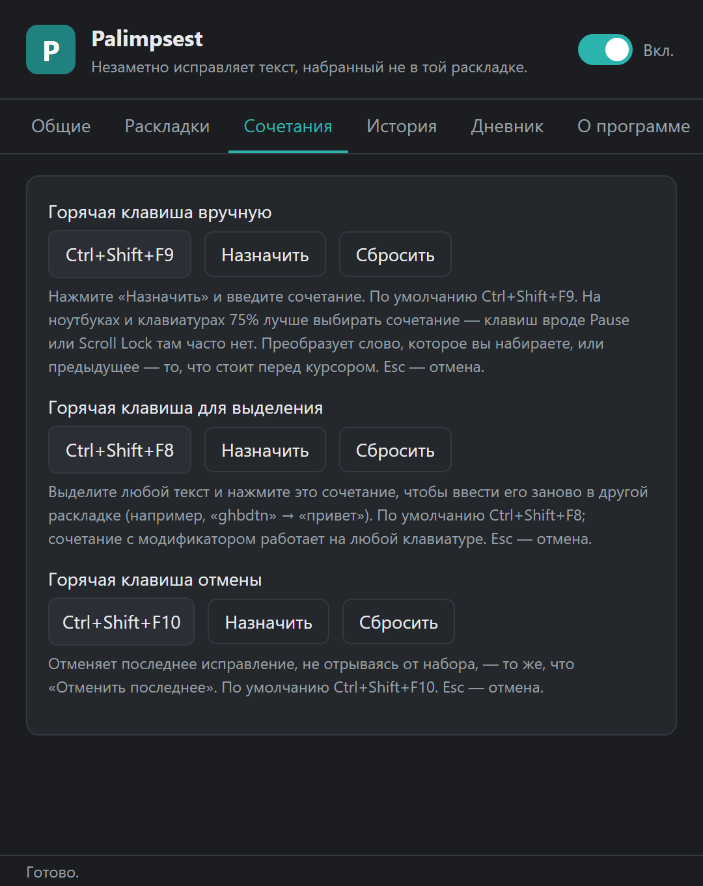
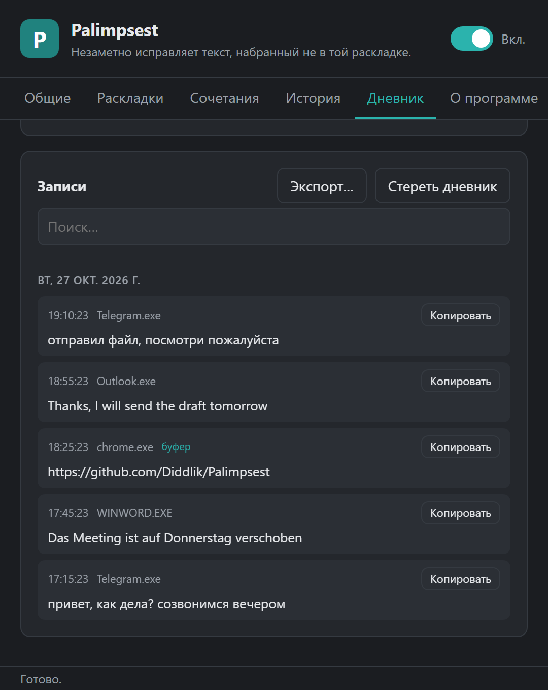

[English](README.md) · **Русский**

# Palimpsest

**Набрали текст не в той раскладке? Palimpsest исправит это раньше, чем вы
заметите.**

Наберите `ghbdtn` при включённой английской раскладке, и Palimpsest превратит
это в `привет`, переключит Windows на русский и даст печатать дальше. Похоже на
Punto Switcher, Mahou или Caramba Switcher, но работает полностью локально,
написано на Rust и исправляет, только когда уверено.


## Установка

Скачайте `Palimpsest_<version>_x64-setup.exe` из
[последнего релиза](https://github.com/Diddlik/Palimpsest/releases/latest) и
запустите. Установка идёт для текущего пользователя, права администратора не
нужны, обновления приходят сами: Настройки → Общие → Обновления.

Установщик пока не подписан, поэтому SmartScreen может предупредить при первом
запуске (**Подробнее → Выполнить в любом случае**).

## Возможности

- **Автоматическое исправление** при наборе: EN ⇄ RU, EN ⇄ DE, DE ⇄ RU и любые
  другие пары алфавитных раскладок.
- **Три горячие клавиши**: преобразовать последнее слово, преобразовать
  выделение, отменить.
- **Осторожность по умолчанию**: ползунок чувствительности, список исключений
  для терминалов, IDE и игр, тишина в полях пароля.
- **Учится на отменах**: отмените исправление один раз, и это слово больше не
  тронут.
- **Дневник набора** (необязательный, выключен по умолчанию): журнал набранного
  с поиском и экспортом, по желанию с буфером обмена и шифрованием паролем.
- **Интерфейс на английском, русском, украинском и немецком**, по умолчанию на
  языке Windows.
- **Приложение в трее**: левый клик ставит на паузу, правый открывает меню.
  Настройки применяются сразу.

## Скриншоты

| История | Раскладки |
|---|---|
|  |  |
| **Сочетания** | **Дневник** |
|  |  |

## Горячие клавиши

| По умолчанию | Действие |
|---|---|
| `Ctrl+Shift+F9` | Преобразовать слово, которое вы набираете, или слово перед курсором |
| `Ctrl+Shift+F8` | Преобразовать выделенный текст |
| `Ctrl+Shift+F10` | Отменить последнее исправление |

Все три можно изменить или отключить в Настройки → Сочетания.

## Приватность

- Набранный текст никогда не покидает компьютер, ни при каких настройках.
- Единственный сетевой запрос — проверка обновлений. Он не передаёт
  идентификаторов, а обновления проверяются по ключу подписи, вшитому в
  приложение.
- Логи диагностики на уровне по умолчанию не содержат набранного текста.

Набранный текст на диск пишут только две функции, обе в
`%APPDATA%\com.palimpsest.desktop\`, и обе можно посмотреть и стереть в
настройках:

- **Выученные слова** (`user_words.json`, включено по умолчанию): одно слово на
  одну отмену, больше ничего.
- **Дневник набора** (`diary.json`, выключен по умолчанию): настоящий журнал
  нажатий. Его может прочитать любой, у кого есть доступ к вашему профилю, если
  не задать пароль дневника, который его шифрует (Argon2id +
  XChaCha20-Poly1305). Забытый пароль восстановить нельзя. Хранение ограничено
  числом записей (500 по умолчанию), возрастом и размером файла.

### Окна администратора

Windows не даёт обычному процессу вводить текст в окна с повышенными правами,
запросы UAC и экран блокировки. Включите **Всегда запускать от имени
администратора** в Настройки → Общие, если нужны исправления в таких
приложениях. Используется одна задача планировщика, подтверждённая через UAC, и
права сохраняются после входа и обновлений.

## Как это работает

Palimpsest работает в трёх потоках:

- **Поток hook** владеет `WH_KEYBOARD_LL`. Он читает клавишу, передаёт крошечное
  событие и сразу возвращает управление, потому что Windows молча снимает
  медленные hook.
- **Поток engine** собирает слово до пробела, переинтерпретирует scan code в
  каждой настроенной раскладке через `ToUnicodeEx` и оценивает каждый вариант
  биграммными моделями языков. Если другая раскладка явно лучше, он отправляет
  Backspace, переключение раскладки и исправленный текст одним вводом.
- **Поток UI** — приложение Tauri 2 в трее с окном настроек.

Собственный ввод помечается через `dwExtraInfo`, поэтому Palimpsest никогда не
исправляет то, что набрал сам. Сочетания вроде `Ctrl+V` сбрасывают текущее
слово, так что вставленный текст не затрагивается.

## Сборка из исходников

Нужны Windows и Rust stable (`x86_64-pc-windows-msvc`).

```powershell
cargo test --workspace
cargo clippy --workspace --examples
cargo run -p palimpsest-app            # трей + настройки
```

Установщик (нужен `cargo install tauri-cli --version "^2"`):

```powershell
cd crates/palimpsest-app
cargo tauri build
# → target/release/bundle/nsis/Palimpsest_<version>_x64-setup.exe
```

### Релиз

Релизы собирает GitHub Actions по тегу `v*`. `scripts/bump.ps1` обновляет
`Cargo.toml`, `tauri.conf.json` и `Cargo.lock` вместе, затем делает коммит,
ставит тег и пушит:

```powershell
./scripts/bump.ps1                 # patch: 0.4.1 -> 0.4.2
./scripts/bump.ps1 -Part minor     # 0.4.2 -> 0.5.0
./scripts/bump.ps1 -Version 1.0.0  # явная версия
./scripts/bump.ps1 -DryRun         # показать план, ничего не менять
```

## Состояние

Всё перечисленное реализовано и входит в релизы. Осталось: подпись кода
сертификатом OV/EV и долгие нагрузочные тесты.

## Лицензия

Apache-2.0, см. [LICENSE](LICENSE).
